<div align="center">

<picture>
  <source media="(prefers-color-scheme: dark)" srcset="ui/public/logo-white.svg">
  <source media="(prefers-color-scheme: light)" srcset="ui/public/logo.svg">
  
</picture>

# Origami Verse

**What if your what-ifs became worlds?**<br>
A multiverse for the real world. Hold NEAR in the futures you like and dollars in the ones you fear.

[](https://testnet.nearblocks.io/address/app.ifverse-staging.testnet)
[](contracts/multiverse)
[](ui)
[](#tests)
[](#tests)
[](#tests)
[](LICENSE)

**[Live app](https://multiverse-lending.vercel.app)** ·
**[Docs](https://multiverse-lending.vercel.app/docs/)** ·
**[Whitepaper](https://multiverse-lending.vercel.app/origami-verse-whitepaper.pdf)** ·
**[Demo video](#demo-video)**

</div>

Origami Verse was formerly IfVerse / Multiverse Lending. The testnet accounts (`*.ifverse-staging.testnet`), the web address and the repository keep earlier working names.

<a name="demo-video"></a>
Demo video: (link)

<p align="center">
  <a href="https://multiverse-lending.vercel.app">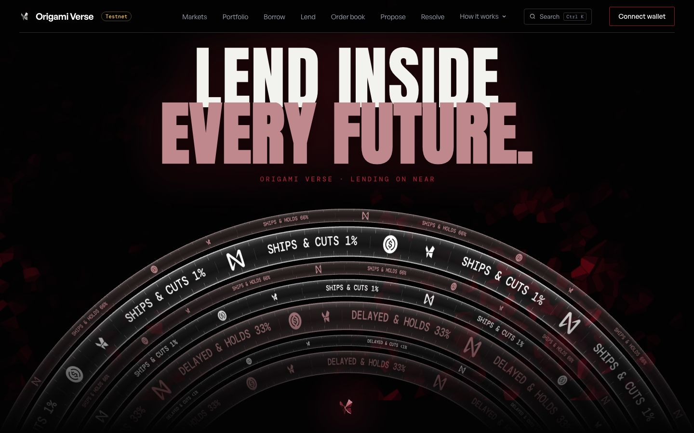</a>
</p>

Origami Verse lets you sell NEAR only in the futures you fear. Pick one to three real events, for example "Will
SPICE ship on NEAR mainnet by Mar 31, 2027?" and "Will the Fed cut at its December 8-9, 2026 meeting?". Every way
those events can turn out is a **world**: two yes-or-no events make four. One wNEAR splits into one NEAR-if-world
token per world, each paying out only if its world comes true. You trade each world in its own pool or order book,
keep NEAR in the worlds you like, sell it for dollars-in-that-world in the ones you fear, and **borrow real USDC
against your worst world**. When the events are answered from their public sources, the worlds that did not happen
die, and what you hold in the surviving world redeems one for one into real wNEAR or USDC.

Everything runs in one Rust contract on NEAR testnet, `app.ifverse-staging.testnet` (version 2.0.0), with test
tokens. The web app is live at **https://multiverse-lending.vercel.app**, with a hosted keeper next to it.

> [!NOTE]
> Testnet only. The wNEAR and USDC here are test tokens that anyone can mint; they have no value. The contract has
> had an internal review by the people who built it, not an audit.

New to all of this? [`docs/LEARN.md`](docs/LEARN.md) explains the project from zero, and the
[docs page](https://multiverse-lending.vercel.app/docs/) is the complete guide in 25 sections (also as plain
Markdown at [`/docs.md`](https://multiverse-lending.vercel.app/docs.md), with [`/llms.txt`](https://multiverse-lending.vercel.app/llms.txt) pointing to it).

## Contents

- [The problem and the idea](#the-problem-and-the-idea)
- [Try it in 5 minutes](#try-it-in-5-minutes)
- [Feature tour](#feature-tour)
- [How it works](#how-it-works)
  - [Events, worlds and masks](#events-worlds-and-masks) · [Verse tokens and the backing rule](#verse-tokens-and-the-backing-rule) · [Prices are chances](#prices-are-chances)
  - [World pools, odds pools and the order book](#world-pools-odds-pools-and-the-order-book) · [Hedging](#hedging)
  - [Worst-world lending](#worst-world-lending) · [Tiers: Safe, Normal, Bold](#tiers-safe-normal-bold) · [Liquidation](#liquidation) · [Insurance and bad debt](#insurance-and-bad-debt)
  - [The outside NEAR/USD check](#the-outside-nearusd-check) · [Resolution](#resolution) · [Proposals and pledges](#proposals-and-pledges) · [The keeper](#the-keeper)
  - [Safety rails](#safety-rails) · [Costs](#costs)
- [What is live now](#what-is-live-now)
- [Architecture](#architecture)
- [For developers and agents](#for-developers-and-agents)
- [Security and invariants](#security-and-invariants)
- [Limitations and what is not built yet](#limitations-and-what-is-not-built-yet)
- [FAQ](#faq)
- [History and disclosure](#history-and-disclosure)
- [Built with](#built-with)
- [License](#license)

## The problem and the idea

Someone holding NEAR who fears one specific future (the upgrade slips and the Fed holds) usually has two tools:
sell NEAR outright, or buy a put. Both pay for protection in every future, including the ones they expect to go
well. A prediction market prices an event, but it does not let you keep NEAR in some combinations of outcomes and
USDC in others, and a lending market does not take a position like "NEAR if the upgrade ships, USDC if it does
not" as collateral. In normal DeFi you can say "sell if NEAR hits $5"; you cannot say "sell if SPICE is delayed".

Origami Verse splits an asset by world, so protection is bought only where it is wanted, and a loan against such a
position is sized by the borrower's worst still-possible world: at the prices lending reads, the collateral covers
the debt in whichever world comes true.

**The idea in one picture.** The main market asks two questions, so there are four worlds. Split 1 wNEAR, sell the
NEAR in the two "Delayed" worlds, keep it in the two "Ships" worlds, and borrow against the result:

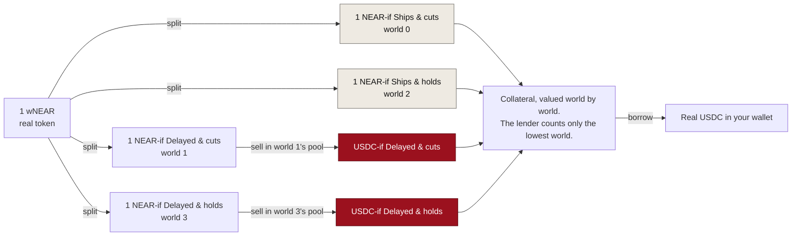

If SPICE ships, you still have your NEAR. If it is delayed, you hold dollars instead, so a NEAR crash after a delay
does not hurt you, and because those dollars do not fall with NEAR, your worst world stays higher and you can borrow
more against it.

The idea in five lines:

1. **Split**: 1 wNEAR becomes one "wNEAR-if-world" token in every world. Together they are always worth exactly 1 wNEAR.
2. **Trade inside a world**: each world has its own NEAR/USDC pool, so you can sell NEAR only in the worlds you fear.
3. **Borrow**: lenders value your collateral in every world and count only the lowest value.
4. **Resolve**: when an event is answered from its public source, the worlds that did not happen die.
5. **Redeem**: when one world is left, its tokens turn back into real wNEAR or USDC, one for one.

## Try it in 5 minutes

Everything below happens on the live site, https://multiverse-lending.vercel.app, on NEAR testnet. Its paths end in
a slash.

**What you need:** a NEAR testnet account in a wallet that NEAR Connect lists on testnet (**Meteor**, **Intear** or
**Nightly** work) and about 0.27 NEAR: 0.1 NEAR for the one-time storage registration plus room for everyday
actions. A transaction pays for the gas it attaches up front and gets back what it does not burn, so an everyday
action needs about 0.17 NEAR free while signing (a pledge, a liquidation or a price check about 0.31) but costs about
0.001.

| # | Do this | You see |
|---|---|---|
| 1 | **Get testnet NEAR.** If you have a funded top-level `.testnet` account (about 0.03 NEAR or more), top it up at https://near-faucet.io (a request is a transaction you sign). With no NEAR at all, run the NEAR CLI command under this table. | The CLI creates a new account holding 10 NEAR from the faucet service. Use `print-to-terminal` in place of `save-to-keychain` to see the key to import into your wallet. |
| 2 | Open https://multiverse-lending.vercel.app. | The landing page, "Lend inside every future". |
| 3 | Click **Markets** in the top bar (under Menu on a phone). | A three-step intro opens once per browser: click Next through it or close it with ×. Then the board: a featured market with its four worlds, search (also Ctrl/⌘+K), category chips and Sort. |
| 4 | Click **Connect wallet** (top right) and pick your wallet. | Your account name replaces the button. |
| 5 | Click your account name, then **Get test tokens**. Approve each step (up to three). | It mints 2,000 test wNEAR and 5,000 test USDC to your own account and pays the 0.1 NEAR storage deposit if you have none. The menu shows your balances. Portfolio has the same button under Wallet. |
| 6 | Open the featured market, `/market/?id=1`. In the ticket on the right, the **Fund** tab: enter 10 wNEAR and press **Split into …**. | One row per world with its chance and NEAR's price there; after the split, **You hold** shows 10 NEAR in each of the four worlds. |
| 7 | **Hedge.** Press **Hedge** on the rows *Delayed & cuts* and *Delayed & holds* (or open the **Hedge** tab), enter the wNEAR to hedge, press **Sell NEAR in 2 worlds**. | One transaction: your wNEAR is split and the NEAR in the two Delayed worlds is sold for USDC in those worlds. You keep NEAR in the two Ships worlds. Turn on **Keep the result as loan collateral** to post it straight into a loan. |
| 8 | **Borrow.** Open **Borrow** (top bar). Pick a tier (Safe, Normal or Bold; Normal is selected). In the ticket on the right, open **Add collateral**, pick **wNEAR**, enter 200 and press **Post to …**; then open **Borrow**, enter 150 USDC (the smallest loan is 100) and press **Borrow 150 USDC**. | Before you sign, the page shows your new health. After: the USDC is in your wallet, and the page shows the health gauge, your collateral in the worst world, and the NEAR price in each world at which your loan could be liquidated. **Repay** takes the USDC back. |
| 9 | **Lend.** Open **Lend**, pick a tier, enter USDC in **Supply** and press **Supply …**. | Your supply in that tier and the rate it earns. **Withdraw** takes it back; **Insure** donates to the tier's insurance fund. |
| 10 | **Pledge.** Open proposal #18, `/proposal/?p=18`. In the **Pledge** box, pick **USDC** (at least 10) or **wNEAR** (at least 3), enter an amount and press **Pledge …**. | The progress bar toward the 47,000 USDC goal moves. Until the market opens, **Withdraw everything** takes it all back; if the proposal ends without opening, every pledge is refunded in full. |
| 11 | Open **Order book** (top bar), pick a world. | Bids and asks in that world, the pool price, a price chart and recent pool trades. A trade fills the best orders first, then the pool. |
| 12 | Open **Resolve** (top bar). | Each event's question, rule, source and where it stands: Open, Proposed, Dispute window, Final. Events 3 and 4 are final, so markets 2 and 3 are settled. |
| 13 | Open **At-risk loans** (footer, `/liquidate/`), tab **All loans**. | Every borrower with a health factor. A loan below 1 can be liquidated for tokens or for cash. |

Step 1, with no testnet NEAR at all ([near-cli-rs](https://github.com/near/near-cli-rs)):

```bash
near account create-account sponsor-by-faucet-service <you>.testnet \
  autogenerate-new-keypair save-to-keychain network-config testnet create
```

Step 5 without the app: the test tokens have an open `mint` (capped per call), so NEAR CLI does the same:

```bash
near contract call-function as-transaction wnear.ifverse-staging.testnet mint \
  json-args '{"account_id":"<you>.testnet","amount":"2000000000000000000000000000"}' \
  prepaid-gas '30.0 Tgas' attached-deposit '0 NEAR' \
  sign-as <you>.testnet network-config testnet sign-with-keychain send

near contract call-function as-transaction usdc.ifverse-staging.testnet mint \
  json-args '{"account_id":"<you>.testnet","amount":"5000000000"}' \
  prepaid-gas '30.0 Tgas' attached-deposit '0 NEAR' \
  sign-as <you>.testnet network-config testnet sign-with-keychain send
```

The testnet demo is shared: what you see is the state that trades, loans and proposals so far have left.

## Feature tour

Screenshots of the live site, taken on 14 Nov 2026 (1440 × 900). Click one to open it full size.

<table>
  <tr>
    <td width="50%" valign="top">
      <a href="docs/images/markets.jpg">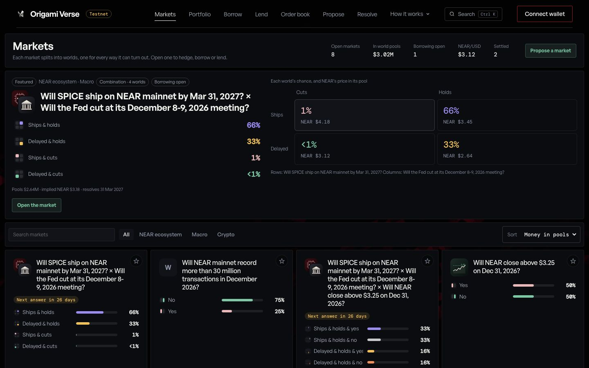</a>
      <br><b>Markets.</b> Ten markets on six real events; the featured one shows each world's chance and NEAR's price in it.
    </td>
    <td width="50%" valign="top">
      <a href="docs/images/market-spice-fed.jpg">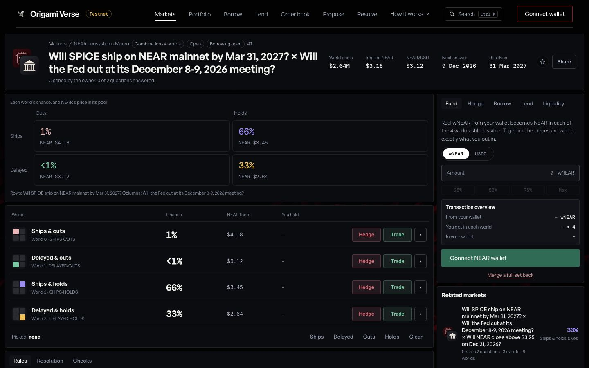</a>
      <br><b>A market.</b> SPICE × Fed: one row per world, Hedge and Trade on each, and the Fund, Hedge, Borrow, Lend, Liquidity ticket.
    </td>
  </tr>
  <tr>
    <td width="50%" valign="top">
      <a href="docs/images/market-eight-worlds.jpg">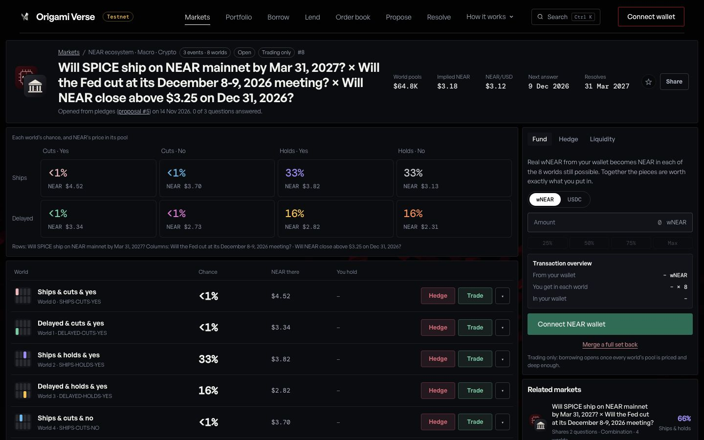</a>
      <br><b>Eight worlds.</b> Market 8 combines three events, the most a market can hold.
    </td>
    <td width="50%" valign="top">
      <a href="docs/images/borrow-loan.jpg">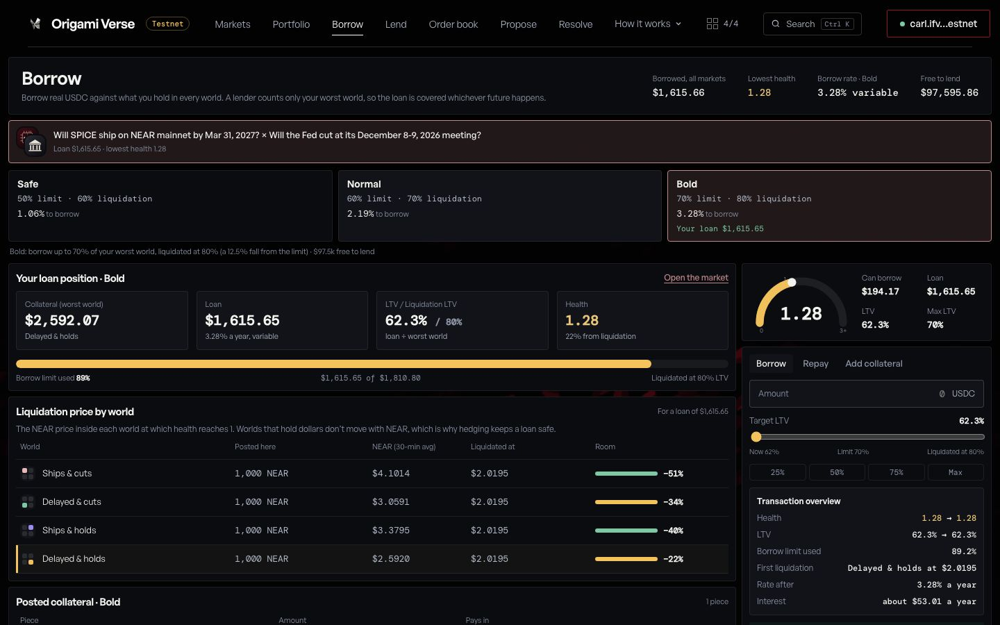</a>
      <br><b>Borrow.</b> A live Bold-tier loan: worst world Delayed & holds, health 1.28, and the NEAR price per world that would liquidate it.
    </td>
  </tr>
  <tr>
    <td width="50%" valign="top">
      <a href="docs/images/order-book.jpg">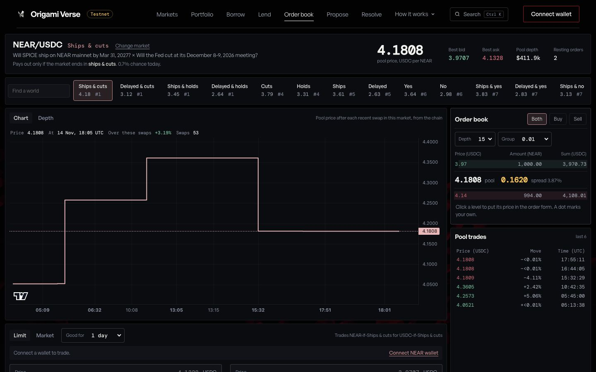</a>
      <br><b>Order book.</b> Bids and asks inside one world, next to that world's pool price and recent pool trades.
    </td>
    <td width="50%" valign="top">
      <a href="docs/images/proposal-18.jpg">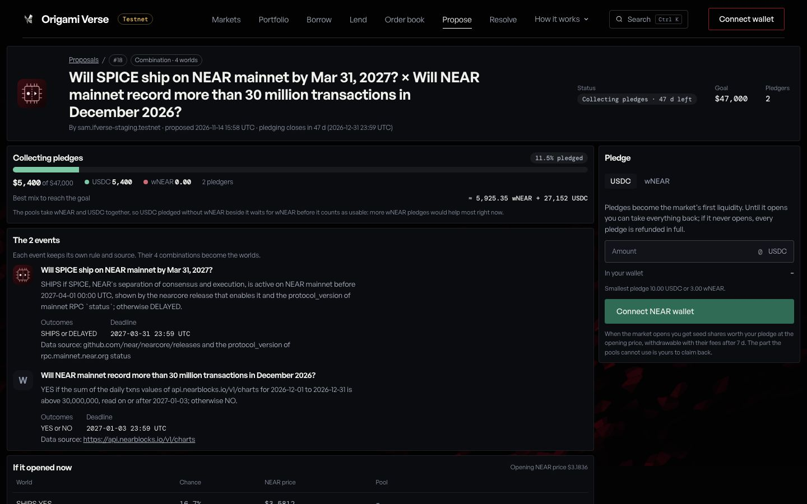</a>
      <br><b>Proposals.</b> #18 (SPICE × December transactions) collecting pledges; it opens by itself at its goal.
    </td>
  </tr>
  <tr>
    <td width="50%" valign="top">
      <a href="docs/images/resolve.jpg">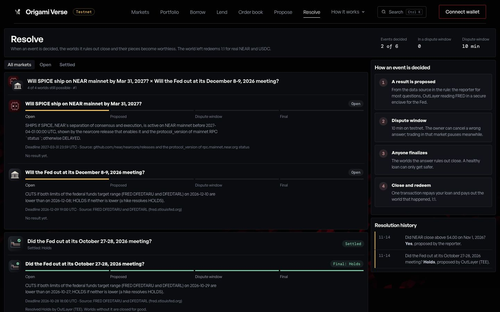</a>
      <br><b>Resolve.</b> Every event's rule and source, its stage, and the two real answers already final.
    </td>
    <td width="50%" valign="top">
      <a href="docs/images/at-risk-loans.jpg">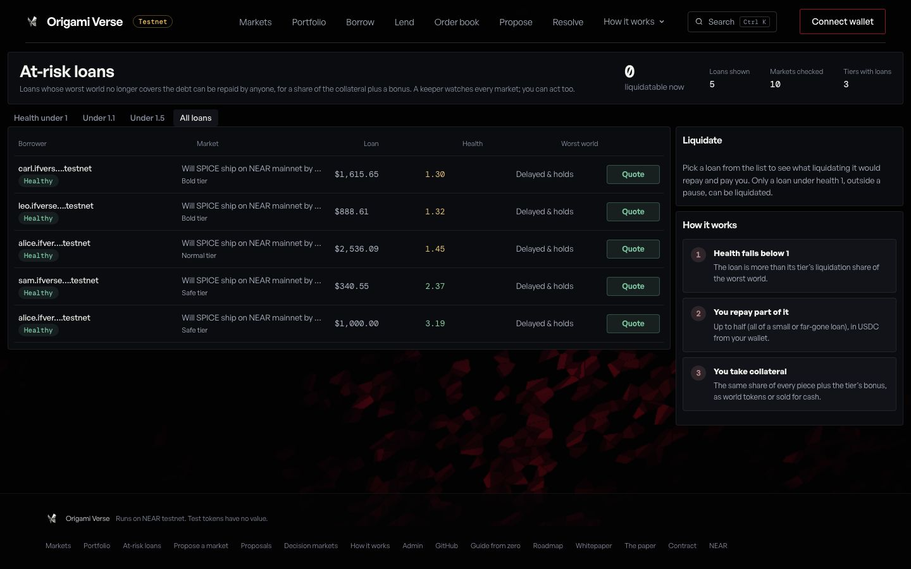</a>
      <br><b>At-risk loans.</b> Every loan with its health and worst world; anyone can liquidate one below 1.
    </td>
  </tr>
  <tr>
    <td width="50%" valign="top">
      <a href="docs/images/docs-worlds.jpg">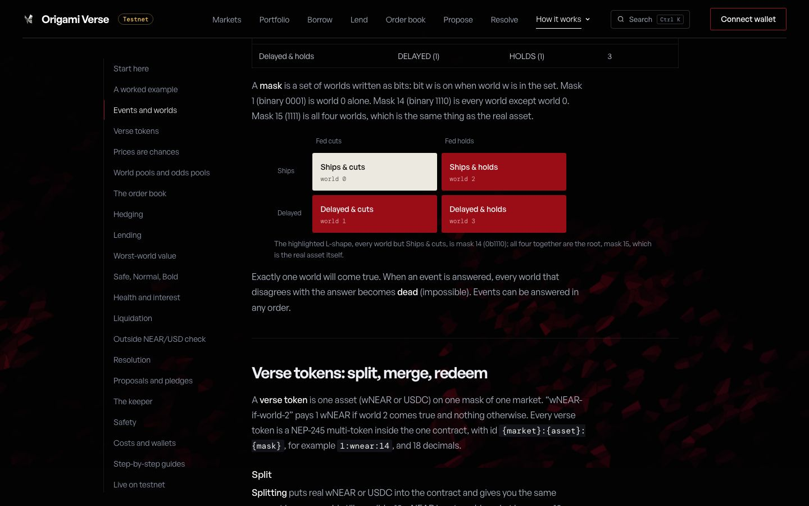</a>
      <br><b>Docs: worlds.</b> The four worlds as a grid; the crimson L-shape is mask 14, every world but Ships & cuts.
    </td>
    <td width="50%" valign="top">
      <a href="docs/images/docs-live-loans.jpg">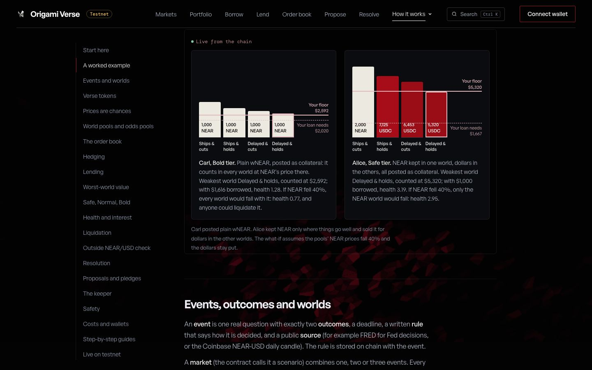</a>
      <br><b>Docs: two live loans.</b> Plain wNEAR against a hedged position, read from the chain, with a what-if of NEAR falling 40%.
    </td>
  </tr>
</table>

## How it works

This is a condensed version of the [docs page](https://multiverse-lending.vercel.app/docs/). Every protocol setting
here is the contract's own (`contracts/multiverse/src`) or a view of the staging deployment on 14 Nov 2026; the view
or constant that holds it is named in `code`.

### Events, worlds and masks

An **event** is one real question with exactly two **outcomes**, a deadline, a written **rule** that says how it is
decided, and a public **source** (for example FRED for Fed decisions, or the Coinbase NEAR-USD daily candle). The
rule is stored on chain with the event.

A **market** (the contract calls it a scenario) combines one, two or three events. Every combination of their
outcomes is a **world**: one event gives 2 worlds, two give 4, three give 8. The contract allows at most 3 events
and 8 worlds per market (`max_events`, `max_worlds` in `get_app_config`).

Worlds are numbered from 0: world = (outcome of event A) + 2 × (outcome of event B) + 4 × (outcome of event C),
where the first outcome counts as 0 and the second as 1. A **mask** is a set of worlds written as bits: bit w is on
when world w is in the set.

| | Fed cuts (0) | Fed holds (1) |
|---|---|---|
| **SPICE ships (0)** | Ships & cuts, world 0, mask 1 (`0001`) | Ships & holds, world 2, mask 4 (`0100`) |
| **SPICE delayed (1)** | Delayed & cuts, world 1, mask 2 (`0010`) | Delayed & holds, world 3, mask 8 (`1000`) |

Mask 14 (`1110`) is every world except world 0. Mask 15 (`1111`) is all four worlds, which is the same thing as the
real asset. Exactly one world will come true. When an event is answered, every world that disagrees with the answer
becomes **dead**. Events can be answered in any order.

### Verse tokens and the backing rule

A **verse token** is one asset (wNEAR or USDC) on one mask of one market: "wNEAR-if-world-2" pays 1 wNEAR if world 2
comes true and nothing otherwise. Every verse token is a NEP-245 multi-token inside the one contract, with id
`{market}:{asset}:{mask}`, for example `1:wnear:14`, and 18 decimals.

- **Split** puts real wNEAR or USDC into the contract and gives you the same amount in every world still possible.
  10 wNEAR in a 4-world market becomes 10 of each of the four. It is free of price risk: exactly one world will
  happen, so one token in every world is worth exactly 1 real token.
- **Merge** is the reverse: the same amount in every world still possible turns back into real tokens, at any time.
- **Redeem**: when the answers leave one possible world, its tokens turn into real wNEAR or USDC one for one. A token
  whose mask covers every world still possible is "collapsed" and redeems too. Tokens of dead worlds are worth
  nothing.

**The backing rule**, the contract's central invariant: in every possible world, for each asset, what all verse
tokens pay in that world adds up to exactly what the contract holds. Anyone can read it per world with the `backing`
view; the contract's tests assert it after their actions (`assert_conservation`); a market page's **Checks** tab
shows it while you hold a position there. It means the contract can always pay every winner in full.

### Prices are chances

A USDC-if-world token pays $1 only if that world happens. If the market thinks the world has a 30% chance, the
token trades near $0.30. So the price of a world's dollar is the market's **chance** for that world, and the chances
of all possible worlds add up to 100%. NEAR inside one world has its own price in that world's dollars. The market's
overall NEAR price, the **implied spot**, is the chance-weighted average: the sum of chance × NEAR price over all
worlds.

On 14 Nov 2026 (about 18:20 UTC) the SPICE × Fed market read, from `list_markets`:

| World | Chance (`odds`) | NEAR price in that world (`world_prices`) |
|---|---|---|
| Ships & cuts | 0.67% | $4.18 |
| Delayed & cuts | 0.33% | $3.12 |
| Ships & holds | 66.0% | $3.45 |
| Delayed & holds | 33.0% | $2.64 |
| **Implied NEAR** (`implied_spot`) | | **$3.18** |

The market thinks NEAR is worth less if SPICE is delayed, and that a December cut is unlikely.

### World pools, odds pools and the order book

A **pool** is an automatic market maker: it holds two tokens and quotes a price from how much of each it holds.
Each market has two kinds:

- **World pools**, one per world, trade NEAR-if-world against USDC-if-world. They set NEAR's price inside each world.
  Lending reads these.
- **Odds pools** trade the dollar of one outcome against the dollar of the other (for example USDC-if-SHIPS against
  USDC-if-DELAYED). They set each outcome's chance.

The SPICE × Fed market has 7 pools (`pool_count`), four of them world pools; the 8-world market has 15. A new
combination of events opens with chances that treat its events as independent; trading corrects that over time.

| Setting | Value | Where |
|---|---|---|
| Swap fee | 0.3%, rising toward 1.5% when the pool's last 8 swaps went mostly one way | `fee_base_pips` 3000, `fee_cap_pips` 15000 |
| Average price lending reads | 30-minute time-weighted average (TWAP) | `twap_window_sec` 1800 |
| Pools pause | from the moment an answer to one of the market's events is proposed until it is final, and for good once the world is dead | |

Next to the pools, each world has an **order book** of standing offers. A **bid** buys NEAR-if-world at your price
(you lock the USDC-if-world); an **ask** sells it (you lock the NEAR-if-world). Orders fill fully or in part, expire,
and can be cancelled for whatever has not filled. Once any event of the market is answered, older orders can no
longer fill. Limits: at least 0.001 NEAR (`MIN_ORDER_AMOUNT`) and 0.0001 USDC per order, at most 64 open orders per
account (`MAX_OPEN_ORDERS_PER_MAKER`), at most 20 fills per trade (16 in an 8-world market; `max_trade_fills`,
`max_trade_fills_8w`).

Use the pool when you want it done now; use the order book when you want a set price and can wait, or when the pool
is thin. On the **Order book** page a trade first fills the best orders (up to five per transaction there), then
swaps the rest in the pool or leaves it as your own limit order, in one transaction. Every trade carries a minimum
you will accept (`min_out`); the site sets it to the quote less 0.5% on the pool part, so if the price moves more
than that before your transaction lands, nothing moves.

### Hedging

The **Hedge** tab of a market does it in one transaction: it takes wNEAR from your wallet, splits it into every
world, and sells the NEAR in the worlds you pick for USDC in those worlds. With **Keep the result as loan
collateral** the result goes straight into a loan position in the tier you choose (the contract action is
`conditional_sell` with `to_lending: true` and a `tier`). A hedge costs the pool fee, the price impact, and the
upside you give up in the worlds where you sold.

### Worst-world lending

Lending happens on markets marked lendable (today: market 1, SPICE × Fed). **Lenders** supply real USDC to a tier and
earn interest. **Borrowers** post collateral (verse tokens and real wNEAR or USDC) in one tier and borrow real USDC,
which leaves the contract into their wallet. A loan is owed the same in every world.

A lender values your collateral separately in each world that is still possible:

- NEAR-if-world counts at NEAR's price in that world, and zero in every other world.
- USDC-if-world counts in full where it pays, and zero elsewhere.
- Real wNEAR counts in every world at that world's NEAR price; real USDC counts in full everywhere.

Then it takes the **lowest** of those values, your **worst world**. Your debt is the same in every world and only
one will come true; the lender does not know which, so the only number that is safe whichever world happens is the
minimum. And because answering an event only removes worlds, the minimum over fewer worlds can only stay the same or
rise: **resolution can never lower a borrower's health**, in any order of answers.

```text
health factor   = worst-world value × the tier's liquidation line ÷ debt     (at 1 or above the loan is safe)
most you can borrow = worst-world value × the tier's borrow line − what you already owe
```

Example in the Normal tier (borrow up to 60%, liquidated at 70%): worst world 1,000 USDC, debt 500 USDC.
Health = 1,000 × 0.70 ÷ 500 = 1.40, and you can borrow up to 1,000 × 0.60 = 600 USDC. If NEAR falls and the worst
world drops to 700 USDC, health = 700 × 0.70 ÷ 500 = 0.98, and the loan can be liquidated.

**Two real loans on market 1**, read from the chain on 14 Nov 2026 at about 18:20 UTC (the docs page draws them
live; the numbers move with prices):

| | Carl, Bold tier: plain wNEAR | Alice, Safe tier: hedged |
|---|---|---|
| Collateral | 1,000 NEAR in each of the four worlds | 2,000 NEAR in Ships & cuts; 7,125 / 6,453 / 5,320 USDC in Ships & holds / Delayed & cuts / Delayed & holds |
| Worst world | Delayed & holds, $2,592 | Delayed & holds, $5,320 |
| Debt | $1,616 | $1,000 |
| Health | 2,592 × 0.80 ÷ 1,616 = **1.28** | 5,320 × 0.60 ÷ 1,000 = **3.19** |
| If NEAR fell 40% in every pool | every world falls with it: health 0.77, liquidatable | only the NEAR world falls: health 2.95 |

This is why hedging helps you borrow: plain wNEAR is weakest wherever NEAR is cheapest and falls in every world when
NEAR falls; dollars in the worlds you fear do not.

For new loans each world's NEAR counts at the lower of its live pool price and its 30-minute average. A world
without a trusted price counts zero toward new loans: for the anchor market a world pool must be 30 minutes old
(`min_age_sec` 1800) and hold 50,000 USDC of depth (`min_depth`), per `get_market_price_config`. The smallest loan is
100 USDC (`min_loan`); one loan holds at most 20 collateral pieces (`max_collateral_pieces`). Interest accrues every
second at the tier's current rate. Repaying and adding collateral are never paused. Once an event of the market is
answered, **Close … and redeem** on the Resolve page repays the loan, takes back all collateral, turns every piece
now certain to pay into real tokens and sends them to your wallet, in one transaction.

### Tiers: Safe, Normal, Bold

A lendable market has three **tiers**, each its own pool of lenders with its own limits and rates. Lenders pick the
risk they want; borrowers pick how much they want to borrow. The 10-point gap between "borrow up to" and
"liquidated at" means a loan that was just opened cannot be liquidated in the same moment.

| Tier | Borrow up to | Liquidated at | Liquidator bonus | Rate at 0% use | Rate at 80% use | Rate at 100% use |
|---|---|---|---|---|---|---|
| Safe | 50% | 60% | 5% | 1% | 5% | 50% |
| Normal | 60% | 70% | 6% | 2% | 8% | 60% |
| Bold | 70% | 80% | 8% | 3% | 12% | 75% |

Rates are yearly borrow rates that follow **utilization**, the share of a tier's USDC that is lent out: gentle below
80% (the kink, `rate_kink`), steep above it. No new loan can push a tier past 90% use (`max_utilization`), so lenders
can usually withdraw. Lenders earn the borrow rate on the part that is lent out, less 10% (`reserve_factor`), which
goes to the tier's insurance fund. These are the contract's compiled defaults (`TierState::builtin`) and the values
the staging tiers hold (`lending_tiers`).

### Liquidation

When a loan's health falls below 1, anyone, a person or a bot, can repay part of the debt with their own USDC and
take collateral in return, plus the tier's bonus.

- **How much:** up to half of the debt per liquidation (`close_factor` 0.5); the whole loan when health is below 0.9
  (`full_liquidation_hf`) or the debt is under 200 USDC (`small_loan`).
- **What the liquidator gets:** the same fraction of every collateral piece, plus the bonus. Cutting every piece by
  the same fraction keeps the worst world the worst.
- **Tokens or cash:** the world tokens themselves, or the contract sells them for USDC in the same transaction
  (`"receive": "cash"`) with a minimum the liquidator accepts.
- **When it waits:** while an answer is proposed and not yet final; while a world's pool is too young or thin to
  price; while the `liquidate` flag is paused (and for 1,800 seconds after it is unpaused, by default); and when a
  fresh outside NEAR price is more than 10% above the pools' price.

The **At-risk loans** page lists every loan below a health you choose and liquidates from there; the keeper also
liquidates on its own.

### Insurance and bad debt

Each tier has an **insurance fund**, filled from 10% of all interest and from donations (the **Insure** tab on the
Lend page; donations cannot be taken back). **Bad debt** is debt left after a loan has no collateral worth anything.
It is written off at once: by the liquidation that takes the last collateral, or by anyone with
`write_off_bad_debt` (the **Write off** button on the At-risk page) for a loan whose collateral is worth nothing in
every possible world. The insurance fund pays first; only what it cannot cover is shared by the tier's lenders. Each
tier's totals are public as `bad_debt_covered` and `bad_debt_socialized` in `lending_tiers` (both 0 on all three
tiers on 14 Nov 2026).

### The outside NEAR/USD check

The world pools could, in theory, drift away from the real NEAR price, so a lendable market compares the NEAR price
its pools imply (from their 30-minute averages) with an outside **reference price**: the median of Coinbase, Kraken,
Gemini and CoinGecko.

| Rule (`get_reference_config`) | Value |
|---|---|
| Posted within this long of being observed (`max_result_delay_sec`) | 300 seconds, and newer than the stored one |
| Accepted range (`min_price`, `max_price`) | $0.10 to $1,000 |
| From OutLayer: sources and spread (`min_sources`, `max_spread_bps`) | at least 3 sources within 2% of each other, checked by the contract; the reporter is trusted on these two, and the keeper applies the same rule before it sends |
| Pools and reference more than 10% apart (`max_deviation`) | new borrowing pauses for that market |
| Pools above the reference | collateral counts at the lower, outside level for new loans |
| Reference at most 300 s old (`liquidation_max_age_sec`) and more than 10% above the pools | liquidation waits, so nobody is liquidated on a crashed pool; otherwise the reference can lower liquidation prices by at most 20% (`max_haircut`) |
| Reference older than 1 hour (`borrow_max_age_sec` 3600) | new borrowing pauses; repaying, adding collateral and leaving never pause |
| Opening a proposed market | also needs a reference at most 1 hour old |

Who posts it: the reporter account (`resolver.ifverse-staging.testnet`) with `report_reference`, run by the keeper;
or an OutLayer enclave through `request_reference` when one is configured (on staging no guest is set today).

### Resolution

Every event has a written rule and a public source. An answer reaches the contract in one of three ways: **the
reporter** proposes an outcome with its evidence (`report_outcome`); **OutLayer** runs a small open program inside a
secure enclave that reads public data and proposes the outcome (`request_resolution`; on staging it reads Fed
decisions from FRED, with 0.005 NEAR attached and at least 240 Tgas, the site attaches 300); or **the owner**
resolves directly (`admin_resolve`), for emergencies.

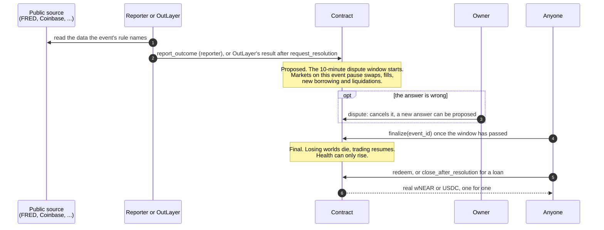

The dispute window is 10 minutes on staging (`dispute_window_sec` 600). While an answer is pending, repaying, adding
collateral and posting or cancelling orders still work. When every event of a market is final, one world is left:
its tokens redeem one for one and loans can be closed.

### Proposals and pledges

Anyone can ask for a new market. There are two kinds of proposal:

| | Kind A: a new event | Kind B: a combination |
|---|---|---|
| What you write | question, two outcome names, rule, source, deadline, category, starting odds | one to three events that already exist and are open |
| Review | the owner approves or rejects within 14 days (`review_ttl_sec`) | none |
| Bond (anti-spam) | 0.2 NEAR (`bond_new_event`), back at approval; back on rejection unless marked spam; back if nobody reviews it in 14 days | 0.05 NEAR (`bond_market`), back when the market opens, or at expiry if at least 10% of the goal was pledged (`spam_floor_bps`) |
| Opening reserve (storage) | 0.1 NEAR (2 worlds) | 0.1 / 0.15 / 0.25 NEAR for 2 / 4 / 8 worlds (`reserve_w2`, `reserve_w4`, `reserve_w8`); what the opening does not spend comes back |

Each proposal has a **goal** in USDC, set by the contract from a target pool depth of 15,000 USDC
(`goal_depth_usdc`), rounded up to the next 1,000 and never under 10,000 (`min_goal_usdc`). Anyone can **pledge**
wNEAR or USDC toward it, at least 10 USDC or 3 wNEAR (`min_pledge_usdc`, `min_pledge_wnear`); pledges count at the
current NEAR price, and since every world pool needs both sides, a goal usually needs some wNEAR too.

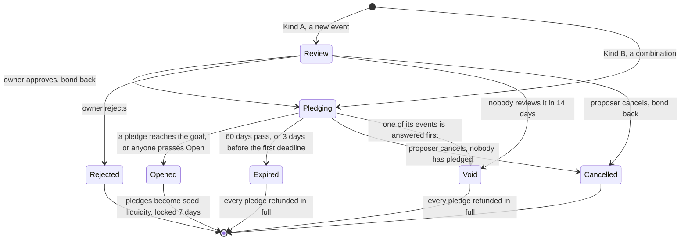

- **Auto-open:** the pledge that reaches the goal opens the market by itself. Opening needs an outside NEAR price at
  most 1 hour old, and the NEAR price the new market starts from (read from the SPICE × Fed market) must sit within
  10% of it (`max_external_divergence_bps`).
- **After opening:** the pledges become the market's starting pool liquidity. Pledgers own it as seed shares, locked
  for 7 days (`seed_lock_sec`); any part the pools did not use can be claimed back (`claim_unused`).
- **Refunds:** before opening, a pledge can be taken back at any time. A proposal expires after 60 days
  (`proposal_ttl_sec`), or sooner so the market keeps 3 days before its first event's deadline
  (`min_market_life_sec`). If it expires, is rejected or ends for another reason, every pledge comes back in full.
- **Limits per account:** at most 4 live proposals (`max_active_per_account`) and 32 pledges
  (`max_pledges_per_account`).

All of these values come from `market_params` on staging. Markets 4 to 10 on the site were opened this way.

### The keeper

A **keeper** is a small program that does routine work nobody should have to do by hand. Ours is a Vercel function
next to the site, `/api/keeper/` (source: [`scripts/api/keeper.ts`](scripts/api/keeper.ts)).

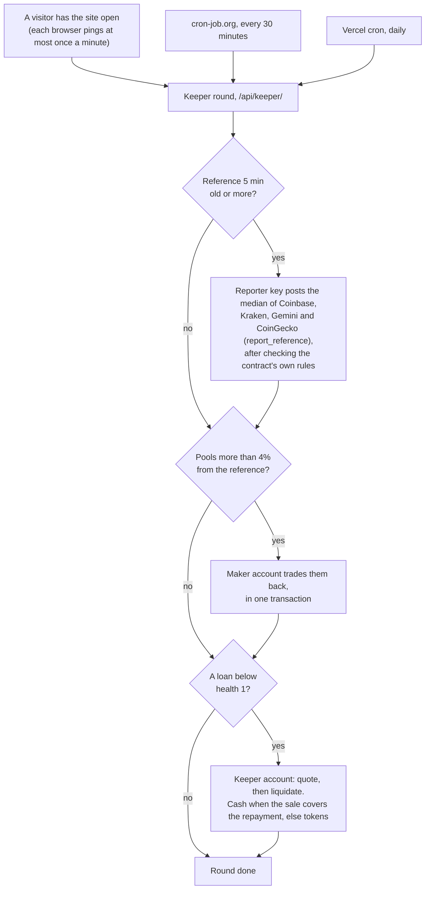

Rounds cannot double up: each key signs with a nonce tied to the current block window, so a second round in the same
window is refused by the chain. **Nothing depends on the keeper for safety**: if it stops, the reference grows stale
and new borrowing pauses, and anyone can still liquidate from the At-risk page.

### Safety rails

- **Pause flags.** The owner (or a guardian, if set) can pause one group of actions at a time: `trade`, `mint`,
  `transfer`, `lend`, `liquidate`, `oracle`, `pledge` and `exit` (only the owner may set `exit` or unpause).
  Repaying, adding collateral, plain deposits, storage deposits and views are never paused. `pause_state` shows what
  is paused; on 14 Nov 2026 nothing is.
- **1 yoctoNEAR on every value-moving call**, which proves a full-access key signed it.
- **Refunds instead of losses.** Tokens arrive with `ft_transfer_call`. If the action fails or uses less than was
  sent, the contract returns the rest in the same transaction. There is no separate token approval step.
- **Storage deposits (NEP-145).** You register once with 0.1 NEAR (`storage_balance_bounds`); the site adds 0.1 NEAR
  more when your free deposit falls under 0.02 NEAR. Returned bonds and reserves land in this deposit;
  `storage_withdraw` sends the free part back.

### Costs

| What | Cost |
|---|---|
| Registering with the contract (once) | 0.1 NEAR, kept as your storage deposit |
| Everyday actions (split, hedge, supply, repay, collateral) | 150 Tgas attached; about 0.17 NEAR must be free when you sign, most of it comes back |
| Heavy actions (pledge, liquidate, propose, open, OutLayer requests) | 300 Tgas; about 0.31 NEAR must be free when you sign |
| Order book page trades | 20 Tgas per order filled, 30 per pool swap, 25 to post an order |
| A new event proposal | 0.2 NEAR bond + 0.1 NEAR reserve |
| A combination proposal | 0.05 NEAR bond + 0.1 / 0.15 / 0.25 NEAR reserve |

On testnet you pay for the gas you attach up front (1 NEAR per 1,000 Tgas) and get back what is not burnt a few
blocks later; real actions burn far less than they attach.

## What is live now

State read from `app.ifverse-staging.testnet` on 14 Nov 2026 at about 18:20 UTC: contract version 2.0.0, 6 events,
10 markets, 24 proposals so far, nothing paused.

### Markets

| # | Events | Worlds | State | Opened by |
|---|---|---|---|---|
| [1](https://multiverse-lending.vercel.app/market/?id=1) | SPICE × Fed December | 4 | open, **lendable** (Safe, Normal, Bold) | owner |
| [2](https://multiverse-lending.vercel.app/market/?id=2) | Fed October | 2 | settled: HOLDS | owner |
| [3](https://multiverse-lending.vercel.app/market/?id=3) | NEAR above $4.00 on Nov 1 | 2 | settled: YES | owner |
| [4](https://multiverse-lending.vercel.app/market/?id=4) | Fed December | 2 | open | proposal #1 |
| [5](https://multiverse-lending.vercel.app/market/?id=5) | SPICE | 2 | open | proposal #2 |
| [6](https://multiverse-lending.vercel.app/market/?id=6) | NEAR above $3.25 on Dec 31 | 2 | open | proposal #3 |
| [7](https://multiverse-lending.vercel.app/market/?id=7) | SPICE × NEAR on Dec 31 | 4 | open | proposal #4 |
| [8](https://multiverse-lending.vercel.app/market/?id=8) | SPICE × Fed December × NEAR on Dec 31 | 8 | open | proposal #5 |
| [9](https://multiverse-lending.vercel.app/market/?id=9) | NEAR mainnet transactions in December | 2 | open | proposal #14 |
| [10](https://multiverse-lending.vercel.app/market/?id=10) | Fed December × NEAR on Dec 31 | 4 | open | proposal #15 |

Markets other than 1 are trading-only. On 14 Nov the three tiers of market 1 held about 105,040, 100,100 and
100,100 USDC of supply, with five open loans (all healthy, the lowest at health 1.28) and no bad debt.

### Events

| # | Question | Outcomes | Source (the full rule is on chain, `get_events`) | Deadline (UTC) | State |
|---|---|---|---|---|---|
| 1 | Will SPICE ship on NEAR mainnet by Mar 31, 2027? | SHIPS / DELAYED | nearcore releases and the `protocol_version` of mainnet RPC `status` | 2027-03-31 23:59 | open |
| 2 | Will the Fed cut at its December 8-9, 2026 meeting? | CUTS / HOLDS | FRED DFEDTARU and DFEDTARL, 2026-12-08 vs 2026-12-10 | 2026-12-09 19:00 | open |
| 3 | Did the Fed cut at its October 27-28, 2026 meeting? | CUTS / HOLDS | FRED DFEDTARU and DFEDTARL, 2026-10-27 vs 2026-10-29 | 2026-10-28 18:00 | **final: HOLDS** (OutLayer) |
| 4 | Did NEAR close above $4.00 on Nov 1, 2026? | YES / NO | Coinbase Exchange NEAR-USD daily candle for 2026-11-01 | 2026-11-01 23:59 | **final: YES** (reporter) |
| 5 | Will NEAR close above $3.25 on Dec 31, 2026? | YES / NO | Coinbase Exchange NEAR-USD daily candle for 2026-12-31 | 2026-12-31 23:59 | open |
| 6 | Will NEAR mainnet record more than 30 million transactions in December 2026? | YES / NO | sum of the daily `txns` of api.nearblocks.io/v1/charts for December, read on or after 2027-01-03 | 2027-01-03 23:59 | open |

### Two events already resolved from real data

| Event | Rule (stored on chain with the event) | Data | Transactions |
|---|---|---|---|
| 3: "Did the Fed cut at its October 27-28, 2026 meeting?" | CUTS if both limits of the federal funds target range (FRED DFEDTARU and DFEDTARL) are lower on 2026-10-29 than on 2026-10-27; HOLDS if neither is lower | DFEDTARU 4.00 and DFEDTARL 3.75 on both dates: HOLDS | `request_resolution(3)` [`GH1fftYY...`](https://testnet.nearblocks.io/txns/GH1fftYYX8RU56GsgyAadCM1yfHHFdmzcvhDdUQrijqy), `finalize(3)` [`5C1dsLUL...`](https://testnet.nearblocks.io/txns/5C1dsLULtK2cnLCneEHwCWtUM86AsBKiWSHdvBLkjYfW) |
| 4: "Did NEAR close above $4.00 on Nov 1, 2026?" | YES if the Coinbase Exchange NEAR-USD daily candle for 2026-11-01 (UTC) closes strictly above 4.00 USD | Coinbase close 4.284, Kraken 4.2827: YES | `report_outcome(4)` [`4JUNNwUA...`](https://testnet.nearblocks.io/txns/4JUNNwUAZzHArvY6TwBtiZftuztFAxiqsQs59rmpyK9R), `finalize(4)` [`C6et7nkC...`](https://testnet.nearblocks.io/txns/C6et7nkCPb6tdLyqZZqw7dnDGHHZfwXpDVvtmZn6vvYw) |

Event 3 went through OutLayer: `request_resolution` pays OutLayer's deposit (0.005 NEAR); OutLayer runs
`oracle/fred-guest` in a TEE worker and resumes the call; the contract proposes the answer with source `outlayer`
under the 10-minute dispute window; then anyone finalizes. The pinned guest is
https://multiverse-lending.vercel.app/outlayer/fred-guest.wasm (408,875 bytes, sha256
`8c809e11f5b4b37627baa5c0a65a8587ef5f3e4918d1e0bb42cb2f87a5ae1660`), the exact output of
`oracle/fred-guest/build.sh`. For event 3 OutLayer reported a 1,572 ms run and charged 0.0011572 NEAR, refunding the
rest. Event 4 was proposed by the reporter's function-call key with the evidence
`Coinbase NEAR-USD 2026-11-01 close 4.284; Kraken 4.2827; threshold 4.00: YES`. To repeat the FRED read without
signing anything: `pnpm -C scripts test:live`. On the first version the same Fed event was event 9, resolved through
OutLayer on 2026-11-12 ([`5DKPy7JX...`](https://testnet.nearblocks.io/txns/5DKPy7JXgjs4UMP8Bpt2AEyepa4QVswQcBRtwu6p4rgk)).

The other four events have not happened yet. They resolve the same way.

### Proposals collecting pledges

| Proposal | Events | Goal | Pledged (14 Nov, 18:20 UTC) | Pledging closes |
|---|---|---|---|---|
| [#18](https://multiverse-lending.vercel.app/proposal/?p=18) | SPICE × NEAR mainnet transactions in December (4 worlds) | 47,000 USDC | 5,400 USDC from 2 pledgers (11.5%) | 2026-12-31 23:59 UTC |
| [#20](https://multiverse-lending.vercel.app/proposal/?p=20) | NEAR above $3.25 on Dec 31 × NEAR mainnet transactions in December (4 worlds) | 45,000 USDC | nothing yet | 2026-12-28 23:59 UTC |

The proposal page shows the best mix to reach the goal; for #18 it was about 5,925 wNEAR plus 27,152 USDC, because
USDC pledged without wNEAR beside it waits for wNEAR before it counts as usable.

### Accounts

| Role | Account |
|---|---|
| Protocol contract (v2.0.0) | [`app.ifverse-staging.testnet`](https://testnet.nearblocks.io/address/app.ifverse-staging.testnet) |
| Owner (approves new events, pause flags, admin resolve) | `ifverse-staging.testnet` |
| Test wNEAR (NEP-141, 24 decimals) | `wnear.ifverse-staging.testnet` |
| Test USDC (NEP-141, 6 decimals) | `usdc.ifverse-staging.testnet` |
| Reporter (proposes outcomes, posts the NEAR/USD reference) | `resolver.ifverse-staging.testnet` |
| Keeper (liquidates loans below health factor 1) | `keeper.ifverse-staging.testnet` |
| Maker (keeps the lendable market near the real NEAR price) | `maker.ifverse-staging.testnet` |
| Personas (lenders, borrowers, order book, proposers) | `alice`, `bob`, `ravi`, `sam`, `uma`, `carl`, `leo` `.ifverse-staging.testnet` |

Explorer: `https://testnet.nearblocks.io/address/<account>`. The same ids are in
[`deployments/staging.json`](deployments/staging.json). Code hashes on chain: the contract runs
`9K62NFX7gQiGajRuLTFcPy7F9n5nADSrFgESttUSFcRR` (deployed with `new()` in one transaction on 2026-11-14 at 04:22 UTC,
[`C3KthRtF...`](https://testnet.nearblocks.io/txns/C3KthRtFPyJa68XRXNqBjvE6LpTqZfPgKsAo2U73bcpU)); both tokens run
`8afCVgFKDom2fYt5BZatMXPLXMiJ1vWHBiUTpN6AyggY`. The first version's contract, `app.multiverse-near.testnet`, is
still on chain and unchanged (code `G6GtUs6AqHfxRb8YCdBx5dv1bgiQ3c1gDhPE9ygQTkEt`, built from commit `04a3d42`,
deployed 2026-11-12 at 12:08 UTC, [`F5X2U1CS...`](https://testnet.nearblocks.io/txns/F5X2U1CSpptsNUEUeeeixcw79ERvfGLFEpREwpnMvWc3)).

<details>
<summary><b>Twenty real transactions on the staging deployment</b> (the smoke runs of 14 Nov 2026, each checked on chain)</summary>

| What happened | Who | Transaction |
|---|---|---|
| The v2 contract deployed | app | [`C3KthRtF...`](https://testnet.nearblocks.io/txns/C3KthRtFPyJa68XRXNqBjvE6LpTqZfPgKsAo2U73bcpU) |
| Split 10 wNEAR into the four worlds of SPICE × Fed | a fresh account | [`8PiGokta...`](https://testnet.nearblocks.io/txns/8PiGoktaQrvKbR9xQVM9sC6q9NVRVL71DxXuQ5eehDDK) |
| Sold that NEAR in one world, Delayed & cuts | the same account | [`5CvVwf2y...`](https://testnet.nearblocks.io/txns/5CvVwf2yLsQZzDVsUvx5XxPCjD9hUmcda8Qh7iHc6q2F) |
| Posted an ask for NEAR in Ships & holds | bob | [`Ar9bjstg...`](https://testnet.nearblocks.io/txns/Ar9bjstgtNF2AFVE15jyFobn6aLAJdfKkAV5A8cAtjNA) |
| Bought 2 NEAR from that ask | the same account | [`Ai3tNvAD...`](https://testnet.nearblocks.io/txns/Ai3tNvAD6sDi6GYjySQMopS5bJCip44fzz9SaTDJ7nT1) |
| Sold NEAR straight into loan collateral | the same account | [`3Us4dxEG...`](https://testnet.nearblocks.io/txns/3Us4dxEGopbRGNY4p8AtdEqRa3JPbqujUR4HJUA9MuB7) |
| Lent 150 USDC to the Normal tier | sam | [`CarV5RRG...`](https://testnet.nearblocks.io/txns/CarV5RRGdwLe1o2o9nJuApGwWZ5oYe213GDkdTMFFzbi) |
| Borrowed 110 USDC | uma | [`6aWQo6ow...`](https://testnet.nearblocks.io/txns/6aWQo6owFhwsuA37oekhRPq4URYWU5Yz19TUJh9ioWsL) |
| Repaid it all | uma | [`Hr8Te74c...`](https://testnet.nearblocks.io/txns/Hr8Te74cVvymD8BLFTzrnnUcg7PsvhivFVy15KHUmVMs) |
| Posted the outside NEAR/USD price | reporter | [`6FiZKCn7...`](https://testnet.nearblocks.io/txns/6FiZKCn78TnTnnUSbMeWGMBqPG1vrRN5tnN4uRDNrqrd) |
| Proposed a new event: NEAR above $3.25 on 31 Dec | sam | [`39Eu1oWY...`](https://testnet.nearblocks.io/txns/39Eu1oWYGZHmj9pMJRsJhVuNenVjzeRLp1QUFXWfZVnz) |
| Approved it | owner | [`7etK5dUx...`](https://testnet.nearblocks.io/txns/7etK5dUxeD6hRCi2n9j1RhLDunZ9PUcKdx6xrdeSYkGp) |
| Proposed the December Fed event as a market | uma | [`F69pf735...`](https://testnet.nearblocks.io/txns/F69pf735E5XLuRnzUJ8hggD5S6bG7AtMQ5b228qXPwZX) |
| The pledge that reached its goal and opened it | alice | [`5vFZLCzA...`](https://testnet.nearblocks.io/txns/5vFZLCzAniB96gvVsudAY9WuMcKqk42ddxh8NXqAViAR) |
| Paused pledges | owner | [`DoaqE9h9...`](https://testnet.nearblocks.io/txns/DoaqE9h9JfiEps8MYPQSu97fLyJsp6uZWM5a4hqGrcET) |
| Unpaused them | owner | [`2hPyr89a...`](https://testnet.nearblocks.io/txns/2hPyr89awCrvpmmHD29Sgauy4Z14EkQtSbXHaxittQMn) |
| OutLayer asked to read FRED for the October Fed meeting | – | [`GH1fftYY...`](https://testnet.nearblocks.io/txns/GH1fftYYX8RU56GsgyAadCM1yfHHFdmzcvhDdUQrijqy) |
| October Fed answer (HOLDS) finalized | – | [`5C1dsLUL...`](https://testnet.nearblocks.io/txns/5C1dsLULtK2cnLCneEHwCWtUM86AsBKiWSHdvBLkjYfW) |
| Reporter answered NEAR on 1 Nov (YES) with evidence | reporter | [`4JUNNwUA...`](https://testnet.nearblocks.io/txns/4JUNNwUAZzHArvY6TwBtiZftuztFAxiqsQs59rmpyK9R) |
| NEAR on 1 Nov answer finalized | – | [`C6et7nkC...`](https://testnet.nearblocks.io/txns/C6et7nkCPb6tdLyqZZqw7dnDGHHZfwXpDVvtmZn6vvYw) |

</details>

## Architecture

The protocol is **one contract**. On NEAR, a call into another contract is asynchronous: it runs as a separate
receipt, usually in a later block, and a failure there does not roll back the caller. A trade that splits NEAR into
four worlds, fills orders, swaps in three pools, posts the result as collateral and borrows against it would need a
callback and a rollback path at every step if pools, order book and lending were separate contracts. In one contract
it is one synchronous call that either completes or panics and leaves nothing changed. The only promises that leave
the contract are payouts of real tokens with `ft_transfer` (sent after every state change), the receiver call of a
NEP-245 `mt_transfer_call`, NEAR refunds, and the OutLayer request.

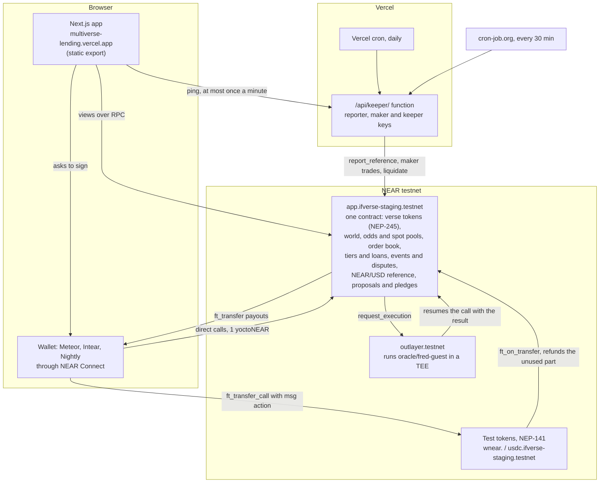

The reporter also proposes outcomes and finalizes them from [`scripts/resolver.ts`](scripts/resolver.ts), with
function-call keys limited to those methods.

### Inside the contract

| Module (`contracts/multiverse/src`) | What it does |
|---|---|
| `receiver`, `router` | `ft_on_transfer` entry point; one-transaction sell, buy, sell-and-borrow, close |
| `core`, `masks` | split, merge, redeem; world and mask arithmetic |
| `ledger`, `nep245` | verse token balances and the NEP-245 multi-token standard |
| `amm` | world, odds and spot pools, fees, TWAP |
| `orders`, `books` | the order book per world |
| `lending` | tiers, worst-world valuation, interest, liquidation, insurance, bad debt |
| `oracle`, `outlayer`, `reference` | events, proposed answers, disputes, OutLayer requests, the NEAR/USD reference |
| `catalog` | proposals, pledges, opening markets, the market list |
| `rootlp`, `storage`, `payout` | the vault, NEP-145 storage, real-token payouts |
| `views`, `admin`, `ops`, `migrate`, `events` | views, owner methods, pause flags and guardian, v1 to v2 migration, NEP-297 events |

[`docs/DESIGN.md`](docs/DESIGN.md) explains how each part works, and the
[whitepaper](https://multiverse-lending.vercel.app/origami-verse-whitepaper.pdf)
([source](whitepaper/origami-verse-whitepaper.tex)) gives the maths.

### Repository layout

| Path | What |
|---|---|
| [`contracts/multiverse`](contracts/multiverse) | The protocol contract (Rust, near-sdk 5.14) |
| [`crates/multiverse-math`](crates/multiverse-math) | Integer maths with no NEAR dependency: fixed point and `mul_div`, tick maths, constant-product pools, dynamic fee, TWAP, odds, shares, order maths, worst-world risk |
| [`contracts/mock-ft`](contracts/mock-ft) | The NEP-141 test token with an open mint capped per call |
| [`oracle/fred-guest`](oracle/fred-guest), [`oracle/nearusd-guest`](oracle/nearusd-guest) | The programs OutLayer runs (WASI, built on their own): FRED reads, and a NEAR/USD reader that is built and served but not configured on staging |
| [`scripts`](scripts) | Accounts, deploy, sandbox, seed, demo sale, reset, resolver, OutLayer, keeper (`scripts/api/keeper.ts` is the hosted function), end-to-end flow (TypeScript, near-api-js) |
| [`ui`](ui) | The live app (Next.js static export, no server) and its docs content ([`ui/src/docs/content.ts`](ui/src/docs/content.ts)) |
| [`deploy`](deploy) | The Vercel project settings for the app and the keeper function |
| [`deployments`](deployments) | Account ids and code hashes per network |
| [`whitepaper`](whitepaper) | The whitepaper's LaTeX source and PDF |
| [`docs`](docs) | [`LEARN.md`](docs/LEARN.md), [`DESIGN.md`](docs/DESIGN.md), [`SECURITY.md`](docs/SECURITY.md), [`TESTING.md`](docs/TESTING.md), [`ROADMAP.md`](docs/ROADMAP.md), and these screenshots |
| [`web`](web) | The earlier interface, kept in the repository, not deployed |

### NEAR features used

- **`ft_transfer_call` with an action.** Every action that takes real tokens is one `ft_transfer_call` whose `msg`
  names it: `deposit`, `split`, `conditional_sell`, `conditional_buy`, `sell_and_borrow`, `post_order`, `supply`,
  `repay`, `deposit_collateral`, `liquidate`, `close_after_resolution`, `lp_deposit`, `spot_swap`,
  `fund_insurance`, `pledge`. No approval step. `ft_on_transfer` returns what the action did not use and the token
  contract refunds it; any failed check panics and the token contract refunds everything. The contract keeps
  18-decimal internal units; for the 24-decimal wNEAR the part of a deposit below one internal unit is returned as
  unused.
- **NEP-245 multi-token positions.** Every world position is a NEP-245 token with id `{scenario}:{asset}:{mask}`,
  e.g. `1:wnear:14`. The contract implements `mt_transfer`, `mt_batch_transfer`, `mt_transfer_call`,
  `mt_batch_transfer_call`, the balance, supply, enumeration and metadata views, and logs `mt_mint`, `mt_burn` and
  `mt_transfer` events for every balance change.
- **NEP-145 storage management.** `storage_deposit`, `storage_withdraw`, `storage_unregister`,
  `storage_balance_of`, `storage_balance_bounds` (minimum 0.1 NEAR). Every state-changing call charges the bytes it
  adds to the payer's deposit and credits the bytes it frees.
- **Function-call keys for the reporter.** `resolver.ifverse-staging.testnet` holds one key that can call only
  `report_outcome` and `finalize` on the contract and another that can call only `report_reference`, each with its
  own NEAR allowance for gas.
- **OutLayer.** `request_resolution` calls `request_execution` on `outlayer.testnet` with a pinned wasm URL and
  sha256; OutLayer runs `oracle/fred-guest` in a TEE (Intel TDX) worker and resumes the call (NEP-519 yield) with the
  result, which `on_outlayer_result` turns into an ordinary proposal under the same dispute window.
- **Named accounts.** The contract, tokens, reporter, keeper, maker and personas are sub-accounts of
  `ifverse-staging.testnet`.
- **NEP-297 events** under the standard `multiverse` for every protocol action.

## For developers and agents

Programs can use the contract directly. The whole guide is also plain Markdown at
[`/docs.md`](https://multiverse-lending.vercel.app/docs.md), and [`/llms.txt`](https://multiverse-lending.vercel.app/llms.txt)
points to it.

### Accounts, decimals and units

| Role | Account | Decimals |
|---|---|---|
| Protocol contract (NEP-245 verse tokens) | `app.ifverse-staging.testnet` | 18 (internal) |
| Test wNEAR (NEP-141) | `wnear.ifverse-staging.testnet` | 24 |
| Test USDC (NEP-141) | `usdc.ifverse-staging.testnet` | 6 |
| Owner | `ifverse-staging.testnet` | |
| Reporter | `resolver.ifverse-staging.testnet` | |

Amounts inside the contract (call args, msgs, views) are 18-decimal integers as strings, whatever the token. The
`amount` of an `ft_transfer_call` is in the token's own units. Example: 25 USDC is `"25000000"` in `ft_transfer_call`
and `"25000000000000000000"` inside a msg.

### Read the chain

Views need no account and no gas. With NEAR CLI ([near-cli-rs](https://github.com/near/near-cli-rs)):

```bash
near contract call-function as-read-only app.ifverse-staging.testnet list_markets \
  json-args '{"from_id":1,"limit":10,"listed_only":true}' network-config testnet now

near contract call-function as-read-only app.ifverse-staging.testnet market_params \
  json-args '{}' network-config testnet now
```

Or with plain JSON-RPC (the public FastNEAR endpoint; back off if it answers 429):

```bash
ARGS=$(printf '%s' '{"scenario_id":1}' | base64)
curl -s https://test.rpc.fastnear.com -H 'Content-Type: application/json' -d '{"jsonrpc":"2.0","id":1,"method":"query",
  "params":{"request_type":"call_function","finality":"final","account_id":"app.ifverse-staging.testnet",
  "method_name":"lending_tiers","args_base64":"'"$ARGS"'"}}' \
  | python3 -c 'import sys,json; print(bytes(json.load(sys.stdin)["result"]["result"]).decode())'
```

| View | Arguments | Returns |
|---|---|---|
| `get_app_config` | `{}` | owner, reporter, tokens, dispute window, TWAP, fees, limits, lending defaults |
| `list_markets` | `{ from_id, limit, listed_only }` | markets with events, worlds, odds, world prices, implied spot, depth, lendable |
| `get_events` | `{ event_ids: [1, 2] }` | questions, rules, outcomes, deadlines, answers |
| `lending_tiers` | `{ scenario_id }` | each tier's supply, borrow, rates, insurance, config |
| `borrowers` | `{ scenario_id, tier, from_index?, limit?, max_health_factor? }` | loans with debt, health factor and worst world (`max_health_factor` `"1000000000000000000"` lists what can be liquidated now) |
| `get_proposal` | `{ proposal_id }` | a proposal's kind, status, goal, pledges, best mix and opening preview |
| `market_params` | `{}` | proposal bonds, reserves, goals, pledge limits |
| `get_reference` / `get_reference_config` | `{}` | the outside NEAR/USD price and its rules |
| `get_market_price_config` / `price_check` | `{ scenario_id }` | how a market prices worlds for lending |
| `backing` | `{ scenario_id }` | the backing rule, per world: reserves against what the tokens pay |
| `pause_state` | `{}` | paused flags |
| `mt_balance_of` | `{ account_id, token_id }` | a verse balance, token id `{market}:{asset}:{mask}` |
| `storage_balance_of` | `{ account_id }` | your NEP-145 storage deposit |

### Write to it

Direct calls attach 1 yoctoNEAR (unless noted) and 150 Tgas:

```text
merge { scenario_id, asset: "wnear"|"usdc", from_masks: [1,2,4,8], to_mask: 15, amount }
borrow { scenario_id, amount, tier? }
withdraw_collateral { scenario_id, piece, amount, tier? }
withdraw_supply { scenario_id, amount | null, tier? }
cancel_order { order_id }
redeem { scenario_id, asset, mask, amount }
close_after_resolution { scenario_id, tier? }
finalize { event_id }                       (no deposit)
propose_market { event_ids }                (deposit = bond + reserve, 300 Tgas)
withdraw_pledge { proposal_id, wnear: null, usdc: null }
open_market { proposal_id }                 (no deposit, 300 Tgas)
storage_deposit { account_id, registration_only }   (0.1 NEAR first time)
```

`tier` is `"safe"`, `"normal"` or `"bold"`; left out, it means Normal.

Real tokens move with `ft_transfer_call` on the token contract, `receiver_id` = `app.ifverse-staging.testnet`,
1 yoctoNEAR attached, and a JSON `msg` (a string) naming the action. The contract refunds what it does not use. The
app builds these in [`ui/src/chain/near/tx.ts`](ui/src/chain/near/tx.ts):

```json
{"action":"split","scenario_id":1,"to_masks":[1,2,4,8]}
{"action":"conditional_sell","scenario_id":1,"sell_mask":10,"plans":[[],[],[],[]],"min_out":["0","…","0","…"],"to_lending":false}
{"action":"conditional_buy","scenario_id":1,"buy_mask":1,"plans":[[],[],[],[]],"min_out":["…","0","0","0"],"to_lending":false}
{"action":"post_order","scenario_id":1,"mask":4,"side":"bid","price":"…","amount":"…","expiry_sec":1797000000}
{"action":"supply","scenario_id":1,"tier":"safe"}
{"action":"deposit_collateral","scenario_id":1}
{"action":"repay","scenario_id":1,"all":true}
{"action":"liquidate","scenario_id":1,"account_id":"…","repay_amount":"max","receive":"cash","min_out":"…"}
{"action":"fund_insurance","scenario_id":1,"tier":"bold"}
{"action":"pledge","proposal_id":18}
{"action":"close_after_resolution","scenario_id":1}
```

`plans` has one array per world: the orders to fill there, as `{ "order_id", "amount" }`; an empty array means the
pool only. `min_out` has one minimum per world, `"0"` where nothing is traded. A tokens-mode liquidation sends neither
`receive` nor `min_out`. For example, splitting 10 wNEAR into the four worlds of market 1 from the command line
(after `storage_deposit`):

```bash
near contract call-function as-transaction wnear.ifverse-staging.testnet ft_transfer_call \
  json-args '{"receiver_id":"app.ifverse-staging.testnet","amount":"10000000000000000000000000","msg":"{\"action\":\"split\",\"scenario_id\":1,\"to_masks\":[1,2,4,8]}"}' \
  prepaid-gas '150.0 Tgas' attached-deposit '1 yoctoNEAR' \
  sign-as <you>.testnet network-config testnet sign-with-keychain send
```

A refused call fails with a short code, for example `Paused(trade)`, `ReferenceStale(4000, 3600)`,
`ReferenceDeviation(…)` or `InsufficientStorage(…)`. The site turns each into plain words.

### Run the app locally

Node 22 and pnpm 10:

```bash
pnpm -C ui install
pnpm -C ui dev:staging   # http://localhost:5173, reads app.ifverse-staging.testnet
```

The hosted app is a static Next.js export of `ui/` plus the keeper function. `web/` is the earlier interface; it
stays in the repository but is not deployed.

### Tests

All commands run from the repository root. Rust 1.86.0 is pinned by `rust-toolchain.toml`.

| Layer | Command | Result |
|---|---|---|
| Rust: maths, contract, mock token | `cargo test --workspace` | 856 passed, 0 failed, 0 ignored |
| Formatting and lints | `cargo fmt --all --check` and `cargo clippy --workspace --all-targets -- -D warnings` | clean |
| The six invariants, with their statistics | `cargo test -p multiverse-contract invariant_ -- --nocapture` | 9 passed |
| OutLayer guest | `cd oracle/fred-guest && cargo test --locked` | 12 passed |
| Scripts | `pnpm -C scripts test` | 464 tests: 463 passed, 1 skipped (the live FRED query) |
| Scripts with live FRED | `pnpm -C scripts test:live` | 18 passed, including the live query |
| App unit tests | `pnpm -C ui install && pnpm -C ui test` | 397 passed in 38 files |
| App typecheck and lint | `pnpm -C ui typecheck` and `pnpm -C ui lint` | clean (lint prints warnings only) |
| Browser flows (Playwright, `ui/e2e`) | see [`ui/INTEGRATION.md`](ui/INTEGRATION.md) | run against the staging deployment with the team's test keys |

The Rust and invariant counts were measured on 2026-11-14 on `d46de5e`; the Rust code is unchanged at `53c6ac1`.
The script and app unit counts were measured on `53c6ac1`. The Rust total is 675 contract unit tests, 103 maths unit
tests, 26 + 15 + 10 + 2 in the maths crate's `tests/pools.rs`, `tests/properties.rs`, `tests/libraries.rs` and
`tests/reference_vectors.rs` (4,188 reference vector lines computed from the prototype's maths), and 25 mock token
tests. [`docs/TESTING.md`](docs/TESTING.md) describes every layer and the six invariants.

<details>
<summary><b>The prototype's golden numbers</b> (checked by <code>golden_demo_sale</code>)</summary>

These are the prototype's numbers, which the first version's seed reproduced; live prices on testnet have moved
since, and v2 replaced the single 75% line with the three tiers. The seed set four world pools at 3.70
(SHIPS·CUTS), 3.00 (DELAYED·CUTS), 3.30 (SHIPS·HOLDS) and 2.50 (DELAYED·HOLDS) USDC per NEAR, and the binary SPICE
market at 3.40 (SHIPS) and 2.80 (DELAYED). DELAYED·HOLDS is the thin pool, with Ravi's standing bid there of 2.4500
USDC per NEAR for 1,000 NEAR. Alice sells 2,000 NEAR in DELAYED·CUTS, SHIPS·HOLDS and DELAYED·HOLDS, keeps it in
SHIPS·CUTS, and borrows 3,000 USDC:

| | |
|---|---|
| 2,000 NEAR into the DELAYED·HOLDS pool alone | 4,748.29 USDC |
| Ravi's bid for 1,000 NEAR, then the pool | 4,881.88 USDC |
| Proceeds in DELAYED·CUTS / SHIPS·HOLDS | 5,865.05 / 6,451.55 USDC |
| Health factor after borrowing 3,000 (worst world DELAYED·HOLDS) | 1.22 (4,881.88 × 0.75 / 3,000) |
| Binary market: 2,000 NEAR-if-DELAYED sold, 3,000 borrowed | HF 1.36 |

The contract test `golden_demo_sale` (`contracts/multiverse/src/tests/router.rs`) checks the per-world proceeds
against the prototype's raw values (within 1e-12 USDC) and the health factor against the prototype's (within 1e-15).

</details>

<details>
<summary><b>The whole flow on a local sandbox node</b> (first version, last run 2026-11-12)</summary>

These scripts drive the first version's acceptance flow on a local nearcore 2.6.5 sandbox node. The run below is
from 2026-11-12 and has not been repeated on v2. It needs `cargo-near` 0.17.0
(`cargo install cargo-near --version 0.17.0 --locked`) and the sandbox binary (the download below was checked on
macOS arm64). The node listens on 127.0.0.1:3030; to use another port, set `SANDBOX_RPC_PORT` for `sandbox` and
`NEAR_RPC_URL=http://127.0.0.1:<port>` for the other scripts.

```bash
curl -sSL "https://s3-us-west-1.amazonaws.com/build.nearprotocol.com/nearcore/$(uname -s)-$(uname -m)/2.6.5/near-sandbox.tar.gz" | tar -xz -C /tmp
export NEAR_SANDBOX_BIN="/tmp/$(uname -s)-$(uname -m)/near-sandbox"

pnpm -C scripts install
pnpm -C scripts build:wasm                        # contract + mock token into target/deploy/
pnpm -C scripts sandbox start --fresh             # node, accounts, tokens, contract, reporter key
NEAR_NETWORK=sandbox pnpm -C scripts seed         # events, scenarios, pools, Bob's supply, Ravi's bid
NEAR_NETWORK=sandbox pnpm -C scripts demo-sale    # Alice sells 2,000 NEAR and borrows 3,000 USDC in both scenarios
NEAR_NETWORK=sandbox pnpm -C scripts e2e          # seeds a fresh demo and runs the acceptance flow
pnpm -C scripts sandbox stop
```

On that run `demo-sale` printed the golden numbers above (worst world DELAYED·HOLDS, HF 1.22, max borrow at HF 1:
3661.41; the TWAP prices depend on how many blocks the sandbox skips), and `e2e` ended with 13 `ok` steps, which
`docs/TESTING.md` lists. After every step that moves tokens `e2e` checks the contract's views and that every world is
still fully backed. The same flow ran on testnet against the first version's contract (code `G6GtUs6A...`) on
2026-11-12 from 12:08 to 12:47 UTC: 88 transactions, the same 13 `ok` lines, with real waits for the 30-minute TWAP
window.

</details>

<details>
<summary><b>The wasm build</b>, and why its hash can differ (two types named <code>ReferenceView</code>)</summary>

```bash
pnpm -C scripts build:wasm
```

It builds both contracts with `cargo near build non-reproducible-wasm --locked`, rewrites local paths out of the
binaries, checks that none is left and prints the sha256 of each. On 2026-11-14 most builds of `main` (`d46de5e`)
printed:

```
7b7fa1502e66cb6467ce9a0823d5277bd248fda2c61e073a5241d26286a9eb54  multiverse_contract.wasm
70a12a7f3432df1f59f176cb756ff4431c59f382ed7f10923bcd831542b3c0a1  mock_ft.wasm
```

In base58 these are the code hashes on testnet: `9K62NFX7gQiGajRuLTFcPy7F9n5nADSrFgESttUSFcRR` on
`app.ifverse-staging.testnet` and `8afCVgFKDom2fYt5BZatMXPLXMiJ1vWHBiUTpN6AyggY` on both token accounts. To read one:

```bash
curl -s https://test.rpc.fastnear.com -H 'Content-Type: application/json' \
  -d '{"jsonrpc":"2.0","id":1,"method":"query","params":{"request_type":"view_account","finality":"final","account_id":"app.ifverse-staging.testnet"}}' \
  | grep -o '"code_hash":"[^"]*"'
```

The contract build is not yet deterministic. Two view types are both named `ReferenceView`
(`contracts/multiverse/src/reference.rs` and `contracts/multiverse/src/catalog/mod.rs`; the JSON each view returns
is not affected), and the ABI that near-sdk embeds in the wasm describes whichever one the build picks, which can
change from one build to the next. Five builds of `d46de5e` in the same checkout printed the hash above three times
and `7ce7b6bcc24d1cf6ef308e6b0ade40ae71b0ebc3af958d8343ea0c1846d0fb27` (base58 `9QaV39eE...`) twice, and a build
from a clean clone printed the second one too. That wasm's embedded ABI differs from the deployed one only in that
definition (all 199 functions are the same) and is 28 bytes shorter. We believe the other differing bytes come from
the same cause: the ABI sits in the wasm's data, so a shorter one moves the data after it, and the 1,043 constants
that differ in the code each differ by 27 to 32. Renaming one of the two types fixes this, as `1ad9891` did for
`RootLpHolding` in the first version, but it changes the wasm and needs a redeploy.

The first version, `app.multiverse-near.testnet`, runs code `G6GtUs6AqHfxRb8YCdBx5dv1bgiQ3c1gDhPE9ygQTkEt`, built
from commit `04a3d42` (sha256 `e0392c0e...`).

</details>

### Deploy and keeper

| Piece | How |
|---|---|
| Contract | `pnpm -C scripts build:wasm`, then `NEAR_NETWORK=staging pnpm -C scripts staging:accounts` (accounts and the two test tokens, written to `deployments/staging.json`) and `NEAR_NETWORK=staging pnpm -C scripts deploy:contract` (deploy + `new()` in one transaction, token registration, the reporter and its two function-call keys); `upgrade` replaces the code of a live contract |
| Web app and keeper | [`scripts/deploy-web.sh`](scripts/deploy-web.sh) builds `ui/` for staging (`pnpm -C ui build:staging`), bundles `scripts/api/keeper.ts` with the deployment's account ids, and deploys both to the Vercel project (`--dry-run` lists the files and deploys nothing) |
| Vercel settings | [`deploy/vercel.json`](deploy/vercel.json): trailing slashes, a 60-second limit for `api/keeper.js`, and a cron on `/api/keeper/`. The plan allows a daily cron, so cron-job.org calls the keeper every 30 minutes and open pages ping it too |
| Keeper secrets (environment only, never in the repository) | `KEEPER_KEY` (keeper account: liquidations), `REPORTER_KEY` (reporter: `report_reference`), `MAKER_KEY` (maker: the maker's swaps and splits), `CRON_SECRET` (sent by the cron as `Authorization: Bearer …`). [`scripts/keeper-env.sh`](scripts/keeper-env.sh) prints the `vercel env add` commands without printing a secret |
| OutLayer | `NEAR_NETWORK=testnet pnpm -C scripts outlayer configure --url <https url> --sha256 <hex>` (owner) pins the guest and gives the event its two FRED dates; `NEAR_NETWORK=testnet pnpm -C scripts outlayer request [--event <id>] [--as <account>]` (anyone) asks for an answer |

## Security and invariants

[`docs/SECURITY.md`](docs/SECURITY.md) is an internal review of the **first version's** contract by the people who
built it, **not an audit**. It lists ten findings (two high, four medium, four low), each reproduced by a failing test
first and kept as a regression test, and the six invariants checked as property tests. The v2 additions (tiers,
proposals and pledges, the NEAR/USD reference, the keeper, the migration code) have their own tests but are not in
that review.

| # | Invariant (stateful property tests: 256 cases of 50 to 200 random actions, checked after every action) |
|---|---|
| 1 | **Backing**: for every market, asset and possible world, the supply of tokens covering that world equals the market's reserves, also with the 24-decimal wNEAR |
| 2 | **Dead stays dead**: nothing on a dead verse succeeds, and a dead token's supply never changes |
| 3 | **Resolution never lowers a borrower's health factor** |
| 4 | **Liquidation covers repayment**: when the worst-world collateral covers the repayment plus the bonus, the seized slice is worth at least the repayment in every possible world |
| 5 | **Order escrow**: every open bid holds at least the cost of its remaining amount, every open ask exactly its remaining amount |
| 6 | **No fill after a resolution or after expiry**, and only the maker can cancel |

Trust assumptions:

- **The owner is trusted.** `admin_resolve` resolves an event at once; `dispute` cancels an open proposal within its
  window. There is no timelock and no multisig.
- **One reporter key proposes outcomes**, and OutLayer proposes the FRED event it is configured for. If the owner does
  not dispute a wrong proposal within its 10-minute window, anyone can finalize it.
- **Most liquidity came from the team**: the seed script and, for markets 4 to 10, the pledges that opened them. The
  maker keeps the lendable market near the reference.
- **The tokens are mocks** that anyone can mint, up to 1,000,000 wNEAR or 10,000,000 USDC per call. They have no value.
- **Testnet only.** Nothing has been deployed or tested on mainnet.

Accepted residual risks (ECON-1 and ECON-2 in `docs/SECURITY.md`): lending prices come from the protocol's own pools,
through a 30-minute TWAP with a spot band; v2 adds the outside NEAR/USD reference, which stops borrowing when a
market drifts more than 10% from it. Someone who holds a pool at a false price for the whole window still moves the
TWAP. The spot band can pause borrowing and liquidation in a world while a pool sits far from its TWAP.

## Limitations and what is not built yet

- **Testnet only, test tokens, not audited.** Nothing here is real money, and nothing has been deployed or tested on
  mainnet.
- **At most three events and eight worlds per market.** Each event doubles the worlds and the pools that need
  liquidity ([`docs/ROADMAP.md`](docs/ROADMAP.md) discusses how to go past it).
- **One lendable market.** Lending runs on market 1 only; each tier's borrow rate follows a fixed kinked curve of
  utilization.
- **Prices lag up to 30 minutes.** Loans use 30-minute averages, so in a fast crash the contract reacts late, and
  someone with enough money could hold one world's price down for that window.
- **The outside price needs the keeper.** If nobody posts NEAR/USD for an hour, new borrowing pauses until someone
  does. An OutLayer NEAR/USD reader (`oracle/nearusd-guest`) is built and served but not configured on staging.
- **New events need the owner.** Combinations of open events do not, but a brand-new event waits for review.
- **Joint odds start out independent.** A new combination opens as if its events did not affect each other; only
  trading corrects that.
- **Proposals need both assets.** A goal usually needs wNEAR as well as USDC, because every world pool needs both
  sides.
- **The v1 to v2 migration has not run on testnet.** The contract has it (`contracts/multiverse/src/migrate`), but the
  staging deployment was made fresh with `new()`.
- **The contract build is not yet deterministic** (see "The wasm build" above); renaming one `ReferenceView` fixes it
  but needs a redeploy.
- **No decision markets yet.** They are described on the [roadmap page](https://multiverse-lending.vercel.app/decision-markets/),
  not in the contract.
- **The testnet demo is shared**: its state is whatever the trades, loans, proposals and tests so far have left.

[`docs/ROADMAP.md`](docs/ROADMAP.md) holds the ideas written before v2; most of them (proposals and pledges, three
events, separate markets, tiers, the borrower list and At-risk page, cash liquidation, insurance, utilization rates,
the outside price check) are built now.

## FAQ

<details>
<summary><b>Is this real money?</b></summary>

No. It runs on NEAR testnet with test tokens that have no value.
</details>

<details>
<summary><b>Why does splitting not cost anything?</b></summary>

Because one token in every world is worth exactly one real token: exactly one world will happen. You only pay gas.
</details>

<details>
<summary><b>Can I lose more than I put in?</b></summary>

You can lose your collateral if your loan is liquidated, but you never owe more than your loan: the USDC you borrowed
is yours to keep.
</details>

<details>
<summary><b>Why can I not borrow on some markets?</b></summary>

Only markets marked lendable have tiers. Today that is market 1, SPICE × Fed. Borrowing also pauses when the outside
price is stale or far from the pools.
</details>

<details>
<summary><b>What happens to my tokens in a world that dies?</b></summary>

They are worth nothing. That is the other side of holding dollars or NEAR only in some worlds.
</details>

<details>
<summary><b>Who decides the answers?</b></summary>

The rule and public source of each event. The reporter or OutLayer proposes; the owner can dispute during the
10-minute window; after it, anyone can finalize.
</details>

<details>
<summary><b>Why did my transaction need 0.3 NEAR when it burned almost nothing?</b></summary>

Testnet charges for the gas you attach when you sign and refunds the unused part a few blocks later.
</details>

<details>
<summary><b>Why is it one contract and not several?</b></summary>

Cross-contract calls on NEAR are asynchronous and do not roll back the caller. Keeping pools, order book and lending
in one contract makes a split-sell-and-borrow one synchronous call that either completes or changes nothing (see
[Architecture](#architecture)).
</details>

<details>
<summary><b>Can a program or a bot use this?</b></summary>

Yes. Read [`/docs.md`](https://multiverse-lending.vercel.app/docs.md), then use the views and the `ft_transfer_call`
messages in [For developers and agents](#for-developers-and-agents). Liquidation is open to anyone, and the
`borrowers` view with `max_health_factor` lists what can be liquidated now.
</details>

<details>
<summary><b>Where do the account names with "ifverse" and "multiverse" come from?</b></summary>

They are earlier working names. The testnet accounts, the web address and the repository kept them when the project
was renamed Origami Verse.
</details>

## History and disclosure

The market design of Origami Verse (then called Multiverse Lending) first existed as a hackathon prototype on an EVM chain
(6-7 Nov 2026); that repository is private. This repository is the NEAR implementation, written from scratch during NEAR HACKATHON: the
Rust contract, the NEAR integration, a new web app and the scripts. The market design and the demo story come from
the prototype.

The idea of splitting an asset into verses, one per possible outcome, and moving tokens down into a verse or back up
comes from Paradigm's essay [Multiverse Finance](https://www.paradigm.xyz/2025/05/multiverse-finance) (Dave White,
May 2025).

## Built with

- Contract: `near-sdk` 5.14, `near-contract-standards` 5.14 (mock token), `uint` (256- and 512-bit integers),
  `borsh`, `serde`; tests with `proptest`.
- Tick maths: a Rust port of Uniswap v4's TickMath (MIT).
- OutLayer guest: `wasi-http-client`, `serde_json`.
- Scripts and keeper: `near-api-js` 7.4.0, `tsx`, TypeScript.
- App (`ui/`): Next.js 16, React 19, three.js 0.187 with `@react-three/fiber`, `@react-three/drei` and
  `@react-three/postprocessing`, `lightweight-charts` 5.2.1, TanStack Query, `@hot-labs/near-connect` 0.12.0,
  `near-api-js` 7.4.0; tests with Vitest and Playwright, lint with oxlint.
- Earlier interface (`web/`): Next.js, React, Tailwind CSS, framer-motion, TanStack Query,
  `@hot-labs/near-connect` 0.12.0, `near-api-js` 7.4.0.
- Hosting: Vercel (static site, keeper function and cron); cron-job.org (the 30-minute keeper call).
- Build: `cargo-near` 0.17.0.
- Data: FRED (Federal Reserve Bank of St. Louis), series DFEDTARU and DFEDTARL; Coinbase, Kraken, Gemini and
  CoinGecko for NEAR/USD; api.nearblocks.io, the source event 6 names.
- Badges: shields.io.

## License

MIT, see [`LICENSE`](LICENSE).
